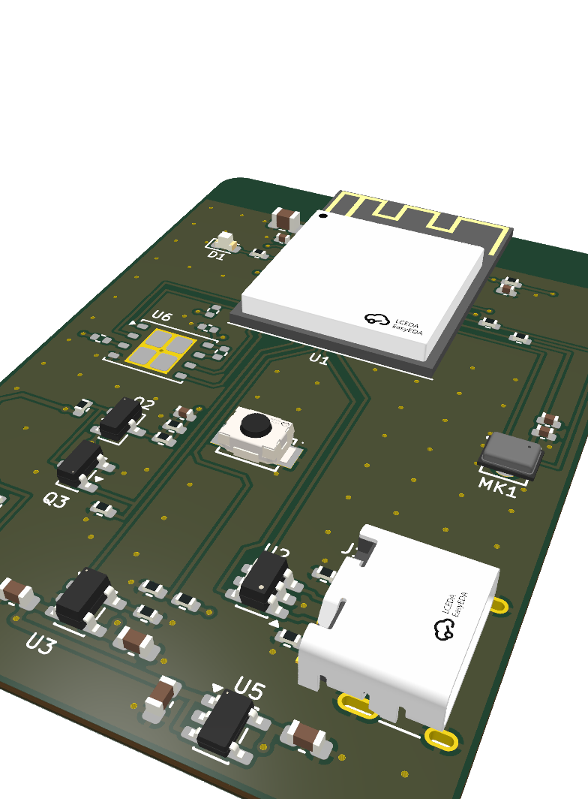
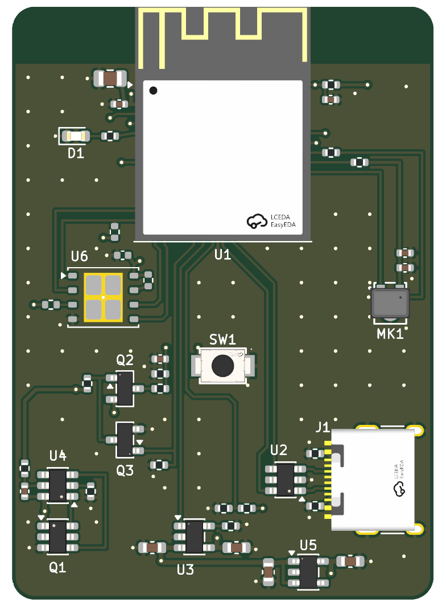
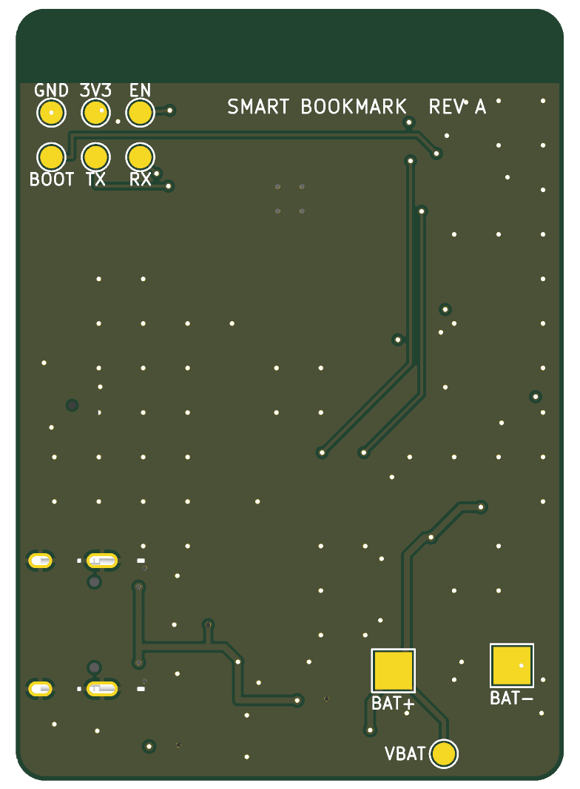

# Smart Bookmark ESP32-S3 BLE

### Ultra-Low-Power Voice Recording & Audio Annotation Bookmark

---

## 3D Hardware Overview

  

  
  

---

## Project Highlights
The **Smart Bookmark** is a commercial-grade, ultra-thin 4-layer hardware device designed to fit cleanly inside a book or notebook. It records spoken voice memos, audio book notes, and timestamps via a single push-button, storing high-quality audio onto 16 MB onboard flash and syncing via Bluetooth Low Energy (BLE 5.0) to an accompanying mobile application.

### Key Features
- **Processor:** Espressif **ESP32-S3-WROOM-1** (Dual-core Xtensa LX7 @ 240 MHz, 2.4 GHz Wi-Fi & BLE 5.0).
- **Audio Capture:** Knowles digital PDM / MEMS microphone (`MK1`) with hardware audio filtering.
- **Local Storage:** 16 MB high-speed SPI NOR Flash (`U6`) dedicated for raw and compressed audio memo storage.
- **Power Management:**
  - Integrated single-cell LiPo charger (`U3`, TP4056/MCP73831 class) with USB-C power input (`J1`).
  - Ultra-low quiescent current 3.3V LDO regulator (`U5`).
  - Precision battery level monitoring voltage divider (`BATT SENSE` / `U4`).
- **Physical Design:**
  - 37.1 × 52.1 mm form factor with rounded corners to protect paper pages.
  - Symmetrical component placement with clear silkscreen identifiers (`STATUS LED`, `16MB FLASH`, `RECORD SW1`, `U3 CHARGER`, `3V3 REG`).
  - Dedicated bottom-side battery cradle target (`CELL 25 × 30 mm`) and 2×3 pogo-pin programming test matrix (`GND`, `3V3`, `EN`, `BOOT`, `TX`, `RX`).
